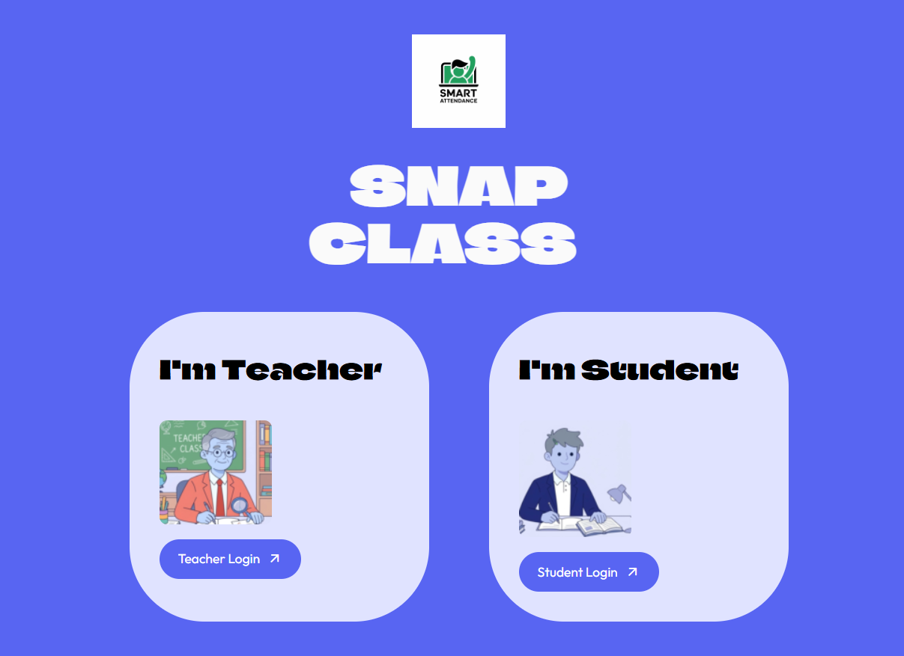
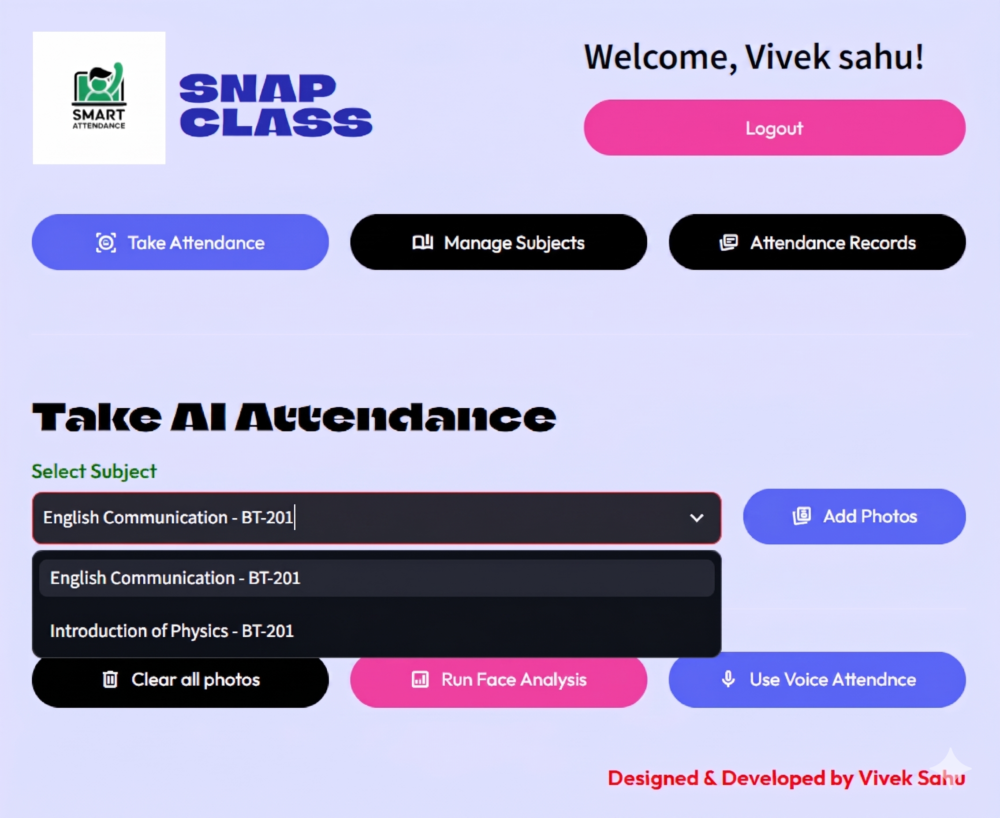
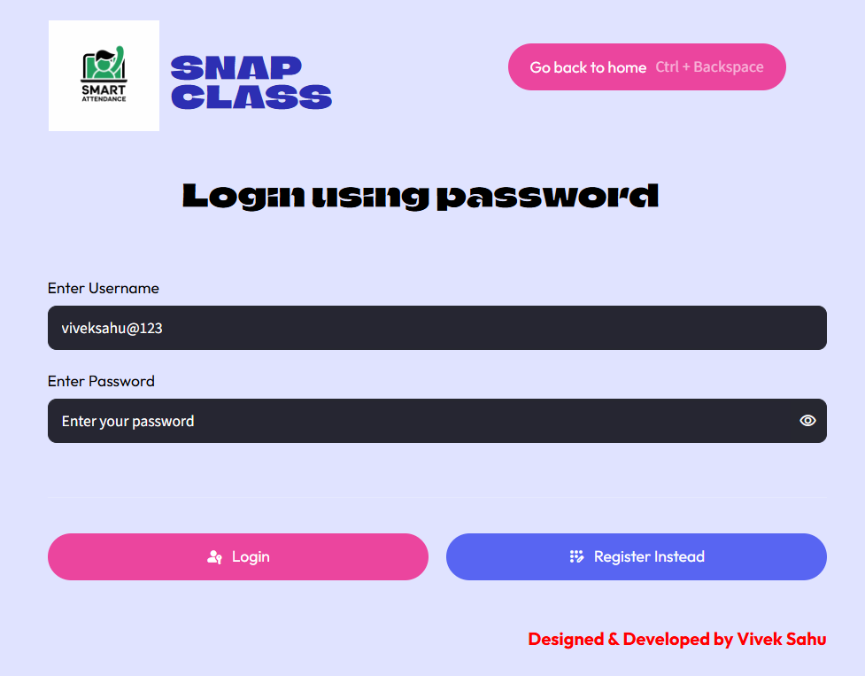
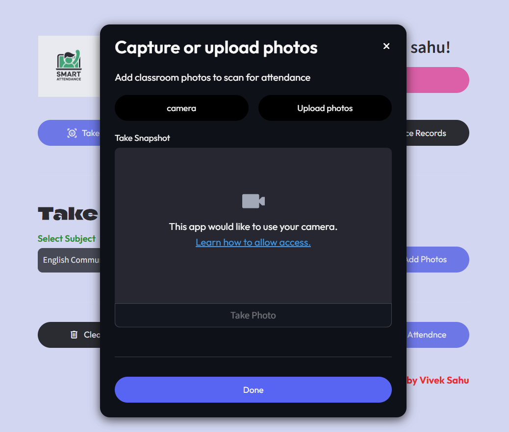
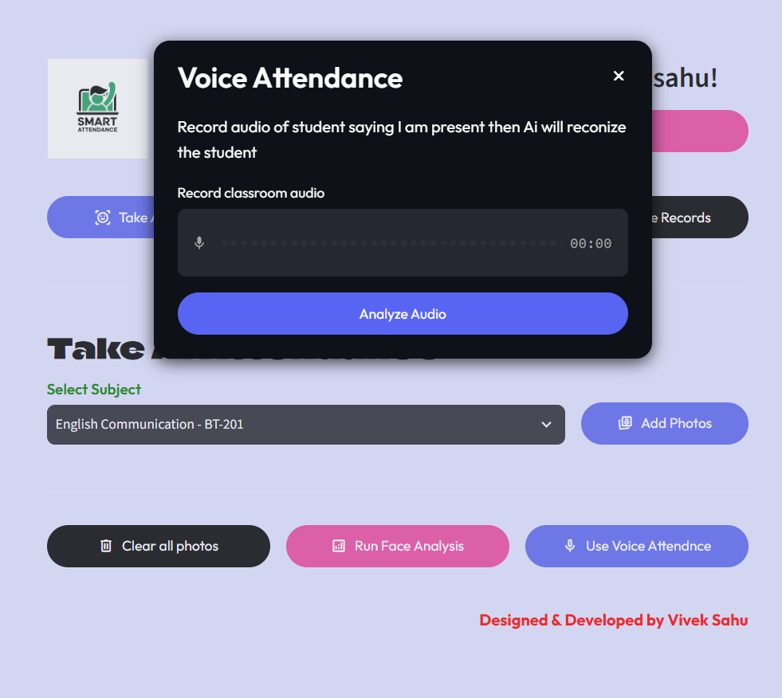
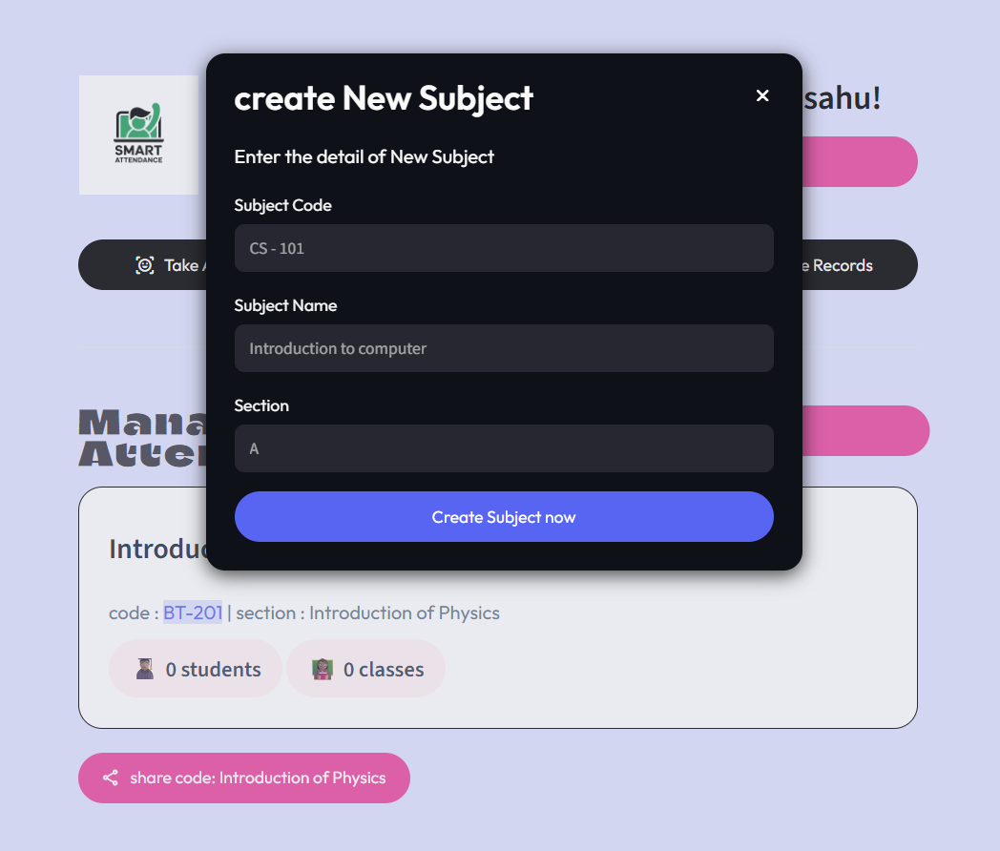
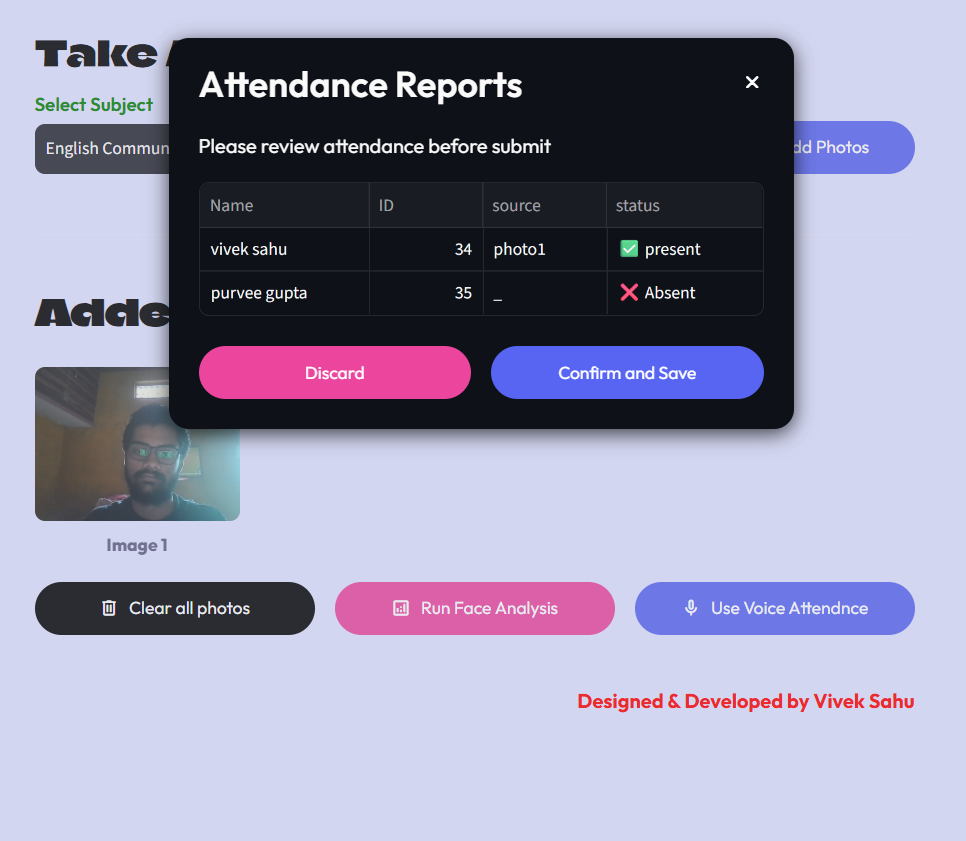

# 🎓 SnapClass — Smart AI Attendance Showcase Website



This repository contains the official **Product Overview & Showcase Website** for **SnapClass** — a next-generation smart attendance system powered by **AI Face Analysis** and **Voice Recognition**. Built with **Python (Flask)**, HTML5, and CSS3, this landing page walks users through the complete architecture, 4-phase workflow, and interactive UI of the SnapClass platform.

---

## ✨ Key Highlights Showcased

* ⚡ **Phase 01 — Instant Enrollment:** Students join courses in seconds using unique QR codes, direct links, or subject dropdowns without tedious sign-up forms.
* 🔐 **Phase 02 — Biometric Registration & Login:** Passwordless check-in using **FaceID** camera alignment and voice authentication.
* 🤖 **Phase 03 — Dual AI Attendance Modes:** 
  * **Face AI Analysis:** Upload classroom photos or capture live images to mark present students automatically.
  * **Voice AI Attendance:** Fast and accurate voice-verified attendance logging.
* 📊 **Phase 04 — Personal Dashboard & Analytics:** Dedicated views for teachers and students to manage subjects (e.g., *English Communication - BT-201*, *Introduction of Physics - BT-201*) and track real-time attendance records.

---

## 📸 Platform UI Previews

| Main Dashboard | FaceID Secure Login |
| :---: | :---: |
|  |  |

| Face AI Attendance | Voice AI Attendance |
| :---: | :---: |
|  |  |

| Course Management | Attendance Records |
| :---: | :---: |
|  |  |

---

## 📂 Project Structure

```text
snapclass-landing-page/
├── app.py                  # Flask application entry point
├── requirements.txt        # Python dependencies
├── templates/
│   └── index.html          # Main showcase landing page template
└── static/
    ├── css/
    │   └── styles.css      # Custom styling and responsive layout
    └── img/                # UI screenshots, logos, and visual assets
